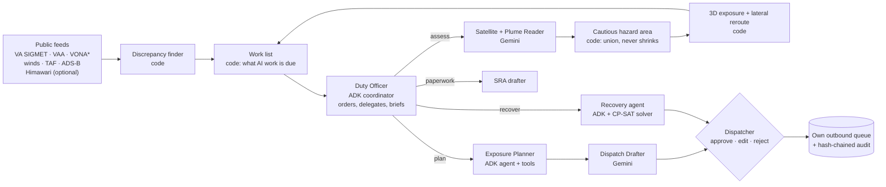

# TEPHRA

**A volcanic-ash decision desk for airline dispatch.** When the official ash products for a volcano differ, TEPHRA works out how they differ and builds the cautious hazard area, which never shrinks below the official one. It then finds which flights are heading into it and drafts an advisory for each of them. A **Duty Officer** agent coordinates the specialist agents that do this work, and a duty dispatcher approves, edits or rejects every draft on a phone.

> **Decision support only. Ring of Fire Air (RFA) is a fictional airline. Nothing is sent to any real system. Not for operational use.**


> **Status (2026-10-12):** as reported in commit `9ada34f`, the test suite (1,281 tests, stub LLM, no network) and `ruff` pass, and the app runs end to end in REPLAY. A live run on the free tier (the `java-live-20261010` case, real Gemini) had the Duty Officer delegate three plume reads, three flight plans (two REROUTE drafts priced at +9 and +10 NM) and network recovery, defer the SRA for budget, and file an accepted brief, with no rate-limit errors. Ask TEPHRA, voice, the Notice Reader, messages, the handover brief and the SRA narrative have not yet been run against the real API. Changes committed after `9ada34f` were checked statically only (`py_compile`, `ruff`, `node --check`) until the suite is run on them again. See [Getting started](#getting-started).

## The problem

On 6 September 2026, ash from Anak Krakatau closed Jakarta's Soekarno-Hatta airport for the first time in its history, along with seven other airports. About 2,961 flights and 341,000 people were affected. During the eruption the observatory's only aviation notice said *"Ash-cloud is not observed"*, while the met office issued 39 SIGMETs with ash up to 50,000 ft ([research/01](research/01-news-2026.md)).

The two official voices often differ:
- the volcano observatory (VONA);
- the Volcanic Ash Advisory Centre (VAA). Indonesian SIGMETs copy the VAA almost exactly (489 of 492 tops match).

Most of their differences are harmless: a lag, a value inside the other's envelope, or a night-time "not observed". But some are real. **In the 30 days to 9 October 2026, 28 of Semeru's 92 observatory ash reports had ash heading where the official ash area did not reach 10 km from the vent** ([research/14](research/14-contradiction-census-30-days.md)). In those cases no single product is "the cautious one".

ICAO Doc 9974 says the operator, not the ash centre, must "reliably and correctly resolve any conflicts that may arise among data sources" ([research/03](research/03-prior-art-products.md), [research/15](research/15-dispatcher-reality.md)). TEPHRA drafts that first pass.

## What TEPHRA does



| Step | Who does it | What it does |
|---|---|---|
| Poll | code | Collects VA SIGMETs (aviationweather.gov), Tokyo and Darwin VAAs (NWS tgftp, public domain), TAFs, Open-Meteo winds and adsb.lol positions. Every record keeps its source, fetch time and sha256. |
| Discrepancies | code | Labels every difference: LAG, ENVELOPE, non-observation, DIRECTION_MISMATCH (including drift outside the polygon), HEIGHT_MISMATCH, SILENCE or CONFLICT. Gemini never decides what counts as a disagreement. |
| Duty Officer | ADK coordinator agent | Gets the work code found due (plume reads, flights to plan, closed airports, paperwork) and decides the order, delegating through one tool per specialist agent below. Defers only optional work, with a reason, and writes a brief for the dispatchers. Code refuses a plan before its volcano's plume read and a deferral of mandatory work; mandatory work left undone goes to the Desk. |
| Satellite Reader | Gemini (Flash-Lite, images) | Looks at the newest JMA Dust RGB and IR frames and says whether ash is visible, whether cloud hides the area, and where. Runs only when the Plume Reader is about to be called and the frame is new. Supporting evidence only: it can raise the hazard, never lower it. |
| Plume Reader | Gemini | Reads the texts, the remarks, the discrepancy list and the satellite reading. Grades each source's evidence, explains it, and proposes a widened area (OFFICIAL / WIDENED / HYPOTHESIS). Code validates the output: only input sources may be cited, no model-written times, never below the official top, size caps. It allows one repair. If that fails the result is `AI UNAVAILABLE` and the cone is the official products alone. |
| Hazard area | code | The union of every valid official polygon and the model's sector. A property test checks that it contains every official polygon. |
| Exposure | code | Projects each aircraft along its track. A flight is exposed only if its pressure altitude band meets the hazard band within the operator policy's vertical margin (2,000 ft, illustrative). Gives minutes to entry. |
| Reroute | code | A lateral route around the hazard: free-route legs between latitude and longitude points (no airways in the free data, and no waypoint is invented), priced in minutes of wind, at most three turn points. The destination comes from VRS standing data when the aircraft is on a known leg. Not in HYPOTHESIS mode. |
| Planner | ADK agent | Uses geometry, alternate, TAF and reroute tools to pick CONTINUE, MONITOR, CHANGE_LEVEL, HOLD, DIVERT or REROUTE (one of the code's routes, by id). HYPOTHESIS mode allows only MONITOR or HOLD. If it cannot produce a plan that passes the checks, the flight goes to the Desk as an AI failure for a dispatcher to handle by hand. |
| Drafter | Gemini | Writes the ACARS-style body. Code writes the header with the flight, UTC times, sources and hashes, and a validator rejects any invented code or time. No draft passes the checks: AI failure on the Desk, no template. |
| Desk | human | Approve, edit (both versions kept) or reject (a reason is required). Only approved advisories reach the outbound queue, which never leaves the store. |

More on the Desk, all drafts until a person decides:

| Feature | Who does it | What it does |
|---|---|---|
| Network recovery | CP-SAT solver, ADK agent | When the hazard closes RFA airports, re-plans a synthetic day of 142 flights in three scenarios (closure as forecast, +3 h, +6 h): delay, cancel or swap, with costs. The agent compares the scenarios and recommends one. |
| Crew and passenger messages | Gemini writes templates, code fills facts | Indonesian, Japanese and English notices for an approved recovery plan; a crew briefing for an approved advisory. A digit outside a placeholder is rejected. |
| Shift handover | code, Gemini for two paragraphs | A WEST and I-PASS brief. Open drafts are listed as handed over open; the incoming dispatcher's read-back records them. |
| Regulator paperwork | code, Gemini for four boxes | A draft safety risk assessment (SRA) and a volcanic activity report (VAR), headed as drafts for human sign-off, with sign-off lines per role. |
| Notices in any language | Gemini, code verifies | Paste a notice in English, Bahasa Indonesia, Japanese or Filipino. Every field needs verbatim evidence; a notice that passes joins the picture like a VONA. JMA eruption reports are parsed by code, with no model. |
| Ask TEPHRA | ADK agent with read-only tools, Gemini voice | Typed or spoken questions about the current picture, with evidence for every claim and what-if checks that change nothing. Spoken answers use Gemini text-to-speech. |
| Backtest | code | Replays the recorded cases and scores TEPHRA's cone against the official areas published later. |

## Where AI is used

All steps run on the free tier; none runs on every tick without a gate.

| Model | Steps |
|---|---|
| `gemini-3.8-flash` (about 20 calls a day) | Plume Reader |
| `gemini-3.5-flash-lite` (about 500 calls a day) | Duty Officer, Exposure Planner, Dispatch Drafter, Satellite Reader, Notice Reader, recovery agent, messages, handover, SRA narrative, Ask TEPHRA, voice transcription, backtest report |
| `gemini-3.8-flash-lite-tts` | Spoken answers in Ask TEPHRA |

There are no fallbacks. When a model fails, runs out of budget or fails the code's checks
after one repair, the step says `AI UNAVAILABLE` and nothing is substituted (HTTP 503 from the
API; a flight with no plan goes to the Desk). With `TEPHRA_LLM=stub` every step has a
deterministic answer for tests, labelled NO MODEL, except voice, which has none.

\* MAGMA VONAs are off by default (`TEPHRA_VONA_LIVE`), because MAGMA's robots.txt disallows crawling. Replays carry recorded VONAs.

Optional: a **split-window layer** computed by code from raw Himawari-9 B13/B15 data (NOAA NODD, read from Google Cloud Storage). It may only widen the area or raise urgency. "No signal" is never read as "no ash", because the method is often blind in moist tropical air ([research/12](research/12-himawari-raw-split-window.md)).

## What is live, what is ours

- **Live and public:** every SIGMET, VAA, TAF, wind and aircraft position, and every timestamp on screen, which is copied from the feeds and never written by a model.
- **Ours, said out loud:**
  - the airline and its queue (fictional);
  - routes extrapolated from track and speed (filed flight plans are not free);
  - the hazard area, which is a hypothesis with a confidence;
  - minutes and fuel from a simple labelled formula;
  - replays, which are always labelled.

## Getting started

```bash
uv sync --extra dev                                   # add --extra science for raw Himawari, --extra gcp for Firestore
uv run pytest                                         # stub LLM, no network
TEPHRA_LLM=stub TEPHRA_LOCAL_SCHEDULER=1 TEPHRA_DESK_PIN=1234 uv run tephra
# Wall: http://localhost:8080/    Desk (phone): http://localhost:8080/desk
TEPHRA_MODE=REPLAY TEPHRA_REPLAY_CASE=<case_id> uv run tephra          # labelled replay
GEMINI_API_KEY=<personal AI Studio key> TEPHRA_LLM=gemini uv run tephra  # real Gemini (free tier ~20 calls/day)
```

All settings are in [`.env.example`](.env.example). Gemini is reached only with a personal `GEMINI_API_KEY`, never through Vertex AI or Application Default Credentials. Daily call budgets stop model calls before the free-tier quota runs out, and the affected step reports `AI UNAVAILABLE`.

| Path | Purpose |
|---|---|
| `/` | The Wall: map, official polygons, the hazard area, aircraft, the three source cards, the live reasoning trace |
| `/assistant` | TEPHRA Assistant at work: the live map of every feed read, the Coordinator, the skills and what waits for you |
| `/desk` | The phone desk: PIN login, draft cards, approve / edit / reject, plus Ask, recovery, messages, handover and documents |
| `/api/wall`, `/api/state`, `/api/events` (SSE), `/api/budget`, `/api/backtest`, `/api/notices`, `/api/recovery`, `/api/docs` | Read endpoints the Wall uses |
| `/api/desk/...` | Desk endpoints (cookie session, CSRF header, optimistic versioning); the full list is in [`MODULES.md`](MODULES.md) section 8 |
| `POST /tasks/tick` | Scheduler tick (`X-Tephra-Task-Token`) |

Deployment to Cloud Run (one service and one Cloud Scheduler job, with Firestore, Secret Manager and Artifact Registry) is in [`deploy/README.md`](deploy/README.md). The scripts there are run by a person from a personal Google account and refuse any other login.

## Evaluation

- `tests/`: unit tests on real recorded feed responses (`tests/fixtures/`). They cover parsers, discrepancy rules on the real Semeru cases, never-shrink geometry, exposure, validators, the model steps' repair and `AI UNAVAILABLE` paths, the reroute geometry, the recovery solver, the desk state machine with its audit hash chain, the store and the API.
- `evals/plume/`: the 10-case Gemini test on Tokyo VAAC's labelled archive (images) plus the Semeru text-reconciliation case, with pass criteria fixed in advance ([evals/plume/README.md](evals/plume/README.md)).
- `scripts/count_traffic.py`: whether there is enough traffic near a volcano for a live per-flight moment.
- `scripts/record_replay.py`: records or reconstructs a labelled replay.

## Research

[`research/`](research/README.md) holds the full research behind TEPHRA:
- news;
- history and costs;
- prior art (commercial products, open source, hackathon entries);
- feed checks;
- rules and terms;
- dispatch practice and ash science;
- a 30-day contradiction census;
- point-by-point answers to the team's own objections.

Every key claim was checked by two independent verifiers. Start with [`research/CONFLICTS.md`](research/CONFLICTS.md) and [`docs/DECISION-MEMO.md`](docs/DECISION-MEMO.md).

**What TEPHRA does not claim:**
- It does not detect ash.
- Per-flight AI advisories with human approval are not new (Jeppesen and The Weather Company have them).
- Its output is not a forecast, a warning or a dispatch release.
- It covers volcanic ash only. SO2 and other volcanic gases, which ICAO notes may also be undesirable to fly through (Doc 9974, definition of volcanic cloud, footnote 1), are not modelled.

What it adds is the evidence reconciliation in front of them.

## Repository map

| Path | Contents |
|---|---|
| `tephra/` | The application (see `MODULES.md` for the contract and `docs/ARCHITECTURE.md` for the design and safety rules) |
| `tephra/web/` | Wall and Desk (plain HTML/CSS/JS, MapLibre GL 4.7.1, OpenFreeMap) |
| `data/` | Volcano and airport catalogues, the operator policy, `routes_apac.json` (VRS standing data, CC0), the synthetic RFA schedule in `rfa/`; `replay/` cases |
| `tests/`, `evals/`, `scripts/` | Tests, the Plume Reader evaluation, recording and counting tools |
| `deploy/` | Cloud Run, Scheduler, secrets and Firestore rules |
| `research/`, `docs/` | Research, decision memo, pitch |
| `.claude/skills/` | Claude Code skills for this repo |

## Licence and data credits

MIT (see `LICENSE`) covers TEPHRA's code. Data and other third-party files in the repo keep their own terms; `NOTICE` lists them. The privacy notice is served at `/privacy` (`tephra/web/privacy.html`): what the Desk records, where it is kept and what is sent to the Gemini API. Data:
- aviationweather.gov and NWS tgftp (US public domain);
- JMA / Tokyo VAAC;
- Bureau of Meteorology / Darwin VAAC (via NWS);
- adsb.lol (ODbL);
- VRS standing data, routes and airports (CC0, via the adsb.lol mirror; `data/routes_apac.json` records the source and SHA-256);
- JMA eruption reports and frames (Public Data License 1.0, credit "Source: Japan Meteorological Agency website");
- Open-Meteo (CC BY 4.0, non-commercial free tier);
- Himawari-9 data: JMA, distributed by NOAA (NODD); read from Google Cloud Storage; processed by TEPHRA (derived products are labelled; no endorsement by NOAA or JMA is stated or implied);
- the volcano catalogue from the Smithsonian GVP.
