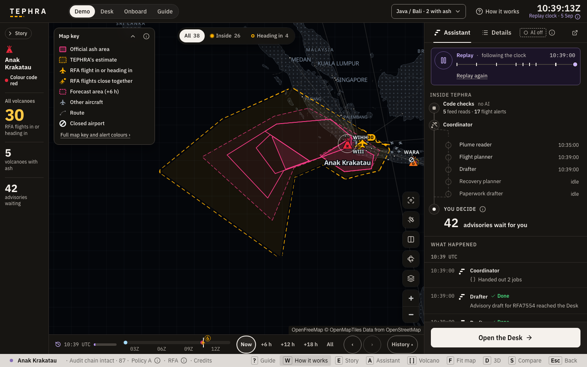
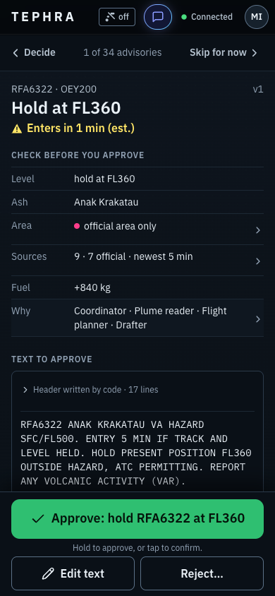
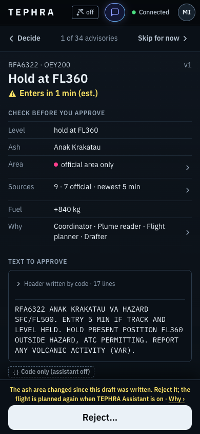
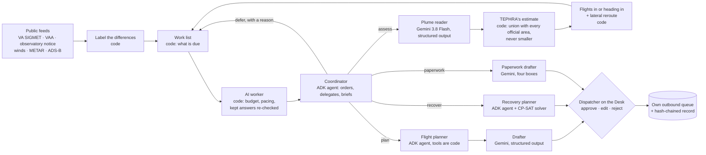
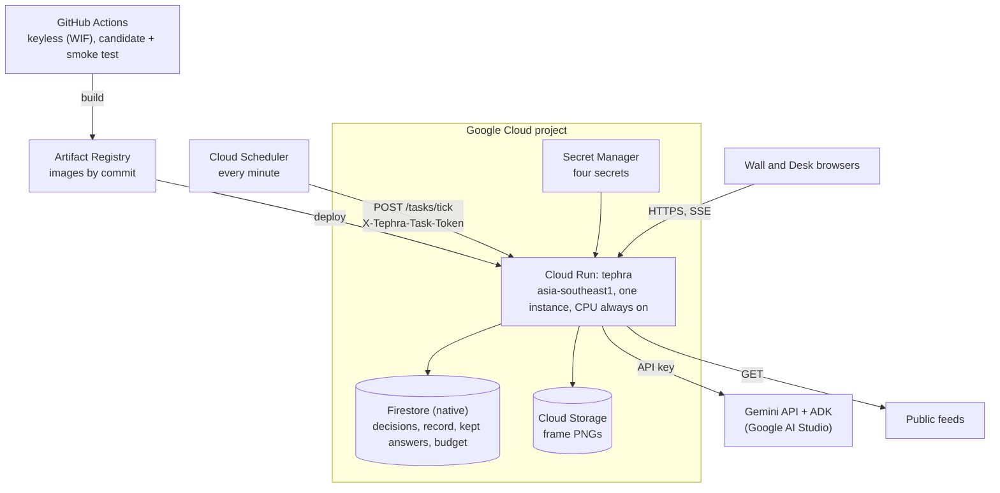

# TEPHRA

**A volcanic-ash decision desk for airline dispatch.** When the official ash reports for a volcano
disagree, TEPHRA shows how, has Gemini propose the cautious area, and holds that area at the official
one: it can widen, never shrink. Code finds the flights heading into it and a lateral route around it;
Gemini drafts an advisory for each; a dispatcher approves every one on a phone.

> Decision support only. Ring of Fire Air (RFA) is a fictional airline. Nothing is sent to any real
> system. Not for operational use.

[Live demo](https://tephra-647733667799.asia-southeast1.run.app) · 

Built on Google Cloud: Gemini (3.8 Flash and 3.5 Flash-Lite through the Gemini API), the Agent
Development Kit, Cloud Run, Cloud Scheduler, Firestore, Secret Manager and Artifact Registry.

## See it in 60 seconds

The Wall: the official ash area (pink) inside TEPHRA's wider estimate (amber), the flights heading
in, and the day's story in two lines. Then the Desk on a phone: a draft advisory checked line by
line, held to approve, and its receipt in the record. These are from the stub replay (code only, no
model); the live demo draws the same screens with Gemini's readings and drafts.

| The Wall (1440) | The Desk review (390) | The receipt (390) |
|---|---|---|
|  |  |  |


```bash
uv sync --extra dev
TEPHRA_LLM=stub uv run pytest                        # no network, no model
TEPHRA_LLM=stub TEPHRA_LOCAL_SCHEDULER=1 TEPHRA_DESK_PIN=1234 TEPHRA_MODE=REPLAY \
  TEPHRA_REPLAY_CASE=anak-krakatau-20260905 TEPHRA_REPLAY_START=2026-09-05T10:30:00Z \
  TEPHRA_REPLAY_END=2026-09-05T19:30:00Z uv run tephra
# Demo http://localhost:8080/demo · Desk http://localhost:8080/desk (PIN 1234) · Guide /guide · Onboard /onboard
```

The demo Desk accepts a visitor sign-in from its sign-in card; visitor decisions are real, audited and
labelled REPLAY.

## 1. The problem, measured

- From 6 to 8 September 2026, ash from Anak Krakatau closed Jakarta's Soekarno-Hatta airport, its
  first full closure, and seven other airports <!-- row 1 -->; the transport ministry counted about
  2,961 flights and 341,000 people affected <!-- row 2 -->. BMKG issued 39 SIGMETs for the volcano
  from 4 September to the morning of 7 September (the count may include cancellations)
  <!-- row 43 -->, and the airport's own weather reports recorded volcanic ash 69 times, from
  01:30 WIB on 6 September to 12:00 WIB on 7 September <!-- row 41 -->. Between 01:30 and 09:30 WIB
  on 6 September, 209 movements and 22,798 passengers at Soekarno-Hatta were affected and 170
  aircraft were held on the apron <!-- row 29 -->.
- From 5 September 02:00Z until the next notice 74.5 hours later, the observatory's only aviation
  notice (2026KRA026) said *"Ash-cloud is not observed"* <!-- row 3 -->; in that window Darwin
  issued 28 advisories, 24 of them with ash at FL500 <!-- row 42 -->.
- The pattern: in the 30 days to 9 October, 28 of Semeru's 92 observatory ash reports pointed where the
  official area did not reach 10 km from the vent <!-- row 4 -->; a Darwin advisory took a median
  228 minutes to reflect a new Semeru notice <!-- row 5 -->; Indonesian SIGMETs copy the Darwin
  advisory (489 of 492 tops) <!-- row 7 -->.
- The duty: ICAO Doc 9974 §2.4(d) says the operator must "reliably and correctly resolve any
  conflicts that may arise among data sources" <!-- row 9 -->. Since 6 September, Indonesia's
  circular SE-DJPU 15/2026 requires a safety risk assessment before flights into ash-threatened
  airspace <!-- row 26 -->.

Most differences are harmless and code labels them. Some are not, and no single product is the
cautious one. TEPHRA drafts that first pass.

## 2. What TEPHRA does



| Step | Who | What |
|---|---|---|
| Poll | code | VA SIGMETs, Tokyo and Darwin VAAs, the observatory's notices, METARs and TAFs, winds and ADS-B positions, each with its source, fetch time and SHA-256. |
| Label the differences | code | LAG, ENVELOPE, non-observation, DIRECTION_MISMATCH, HEIGHT_MISMATCH, SILENCE or CONFLICT. Gemini never decides what counts as a disagreement. |
| Coordinate | Coordinator (ADK) | Orders the work code found due and hands it out through tools; defers only optional work, with a reason; writes a brief that code checks. |
| Read the plume | Plume reader (Gemini) | Grades each source's evidence and proposes TEPHRA's estimate: official-only, widened or hypothesis, with the source leaned on. |
| Build the cautious area | code | The union of every valid official polygon and the proposal. It contains every official area, always. |
| Find flights and reroutes | code | Projects each RFA flight along its track and level; computes a lateral route around a superset of the estimate, or a status when none is found. |
| Plan and draft | Flight planner (ADK), Drafter (Gemini) | One action per exposed flight from the code's options, then an advisory body; code writes the header. |
| Decide and record | dispatcher | Approve, edit or reject on the Desk. Approved drafts go only to TEPHRA's own queue; every transition is a line in the hash-chained record. |

Also on the Desk: an airport plan (a CP-SAT solver re-plans the day's RFA flights around closed
airports; the Recovery planner compares its scenarios), Ask with evidence behind every claim, and
paperwork (a draft safety risk assessment, a volcanic activity report and a shift handover).
Further skills (satellite reading, pasted notices, crew reports, airline data push, voice) are in the
tree behind `TEPHRA_FEATURES`; the demo shows the hero path and these three.

## 3. How Gemini is used, beyond a prompt

| Skill | Model tier | Input | Structured output | Validator | On failure |
|---|---|---|---|---|---|
| Plume reader | Gemini 3.8 Flash | official texts inside `<source>` fences, the disagreements, winds by level | `PlumeEstimate` | cited sources only, no clock times, never below the official top, every number in the prose from the texts | official area only, labelled |
| Coordinator | Flash-Lite, ADK | the work list and a code-written digest | `DutyBrief` through tools | mandatory work cannot be deferred; the brief's flights and numbers from what it saw | undone mandatory work goes to the Desk |
| Flight planner | Flash-Lite, ADK | `PlannerContext`: levels, alternates screened against TAFs, reroutes, costs | `PlannedAction` | the mode decides the allowed actions; a reroute only by id; no hold in the ash | the flight goes to the Desk by hand |
| Drafter | Flash-Lite | the plan, with no clock times | `DraftText` | every number and place from the input; the route string verbatim; no engine-handling words | no draft, said on the Desk |
| Recovery planner | Flash-Lite, ADK | the solver's scenarios | a recommendation | every number from a tool result | no recommendation |
| Message drafter | Flash-Lite | a template spec | a template per language | a digit outside a placeholder is rejected; code fills every fact | no message |
| Paperwork drafter, Handover drafter | Flash-Lite | the evidence of a region or a shift | four boxes; two fields | numbers and ids from the input | blank boxes |
| Ask | Flash-Lite, ADK | a question and read-only tools | claims with evidence | every number, flight and ICAO code in a cited tool result | the question is refused |

The model never writes a time, an id, a hash, a coordinate or a number that is not in its input;
every output has a validator and at most one repair. An answer that fails is `AI UNAVAILABLE` and
nothing is substituted. The message templates are the clearest case: Gemini writes words with
placeholders, code fills every fact, and a digit outside a placeholder is rejected.

**ADK in TEPHRA.** The Coordinator and the Flight planner are ADK agents with tools that are code;
Ask is an ADK agent whose tools only read.

| Agent (`LlmAgent`) | Tools, all code | Session state | Turn cap |
|---|---|---|---|
| Coordinator, one run per work list | `assess_volcanoes`, `plan_flights`, `run_recovery`, `draft_sra`, `defer`, `submit_brief` | the work list and what each tool returned | 12 |
| Flight planner, one run per flight | `get_flight`, `list_alternates`, `check_alternate`, `list_reroutes`, `check_level_band`, `estimate_cost`, `submit_plan` | `tephra_ctx`: the flight's `PlannerContext` | 10 |
| Recovery planner, around the solver | `disruption`, `run_scenario`, `compare`, `submit_recommendation` | the closures and scenarios | 16 |
| Ask, one run per question | read-only runtime readers and what-if checks that change nothing | the picture's version | 10 |

Every agent shares the same callbacks (`agents/adk_runtime.ModelGuard`): `before_model_callback`
caps the turns, waits for the per-minute pacing slot and counts one call against the day's budget in
the store before the attempt; `on_model_error_callback` closes the model for the quota day on a 429;
`on_tool_error_callback` returns the error to the model. Each gets one repair turn when its output
fails the code's checks; past the budget the step reports `AI UNAVAILABLE`.

Not used, and why: `AgentTool` and `sub_agents` (the Coordinator delegates through tools that are
code, so code holds the safety line and counts every turn); grounding (public feeds are the only
evidence, and a claim must cite a source code fetched); context caching (an answer is kept by the
content of its question instead, and re-checked before reuse); thinking summaries (nothing a model
writes reaches the screen without a validator, and thought text has none).

## 4. Robustness and safety rules

| Rule | Enforced in |
|---|---|
| The estimate never shrinks below any valid official polygon | `geo/cone.build_cone` (a union, never simplified) and the property tests in `tests/test_geo_props.py` |
| With no official polygon only MONITOR or HOLD may be advised | `agents/validators.validate_decision`; refused again at approve time: `desk/approvals` answers 409 `rule_blocked` |
| A draft whose situation changed cannot be approved | `desk/approvals`: the cone of the moment is compared with the draft's; only Reject stays open |
| No model-written times, ids or hashes | validators reject clock times; `dispatch_drafter.render_header` writes them from provenance |
| No invented places or numbers | `validators.validate_draft`; `plume_reader` checks every number in the prose against the source texts |
| A source text cannot speak as the prompt | each product text sits in a `<source>` fence it may not open or close |
| A feed outage never reads as an empty sky | `feeds.adsb`, `feeds.vaac` and `feeds.registry` raise or mark STALE instead of answering nothing |
| Nothing leaves TEPHRA | `desk/approvals` writes only to `outbound`; `HttpSource` is GET-only |
| Every transition is recorded | `desk/audit`: append-only, hash-chained; `GET /api/audit/verify` walks the chain |
| The free tier is counted before every call | per-model daily budgets in the store, paced through the day; no step runs every tick without a gate |
| Kept answers are re-checked | the same model's answer to the same material question passes the same validators again before use, keeps its original time, and is never shown in place of a refused one |
| REPLAY is always labelled | the page title's `REPLAY` prefix, the Wall's "Replay clock", every advisory header and every record line |
| No secrets in the repo; Gemini only through an AI Studio key | `config.Settings` reads the environment; `apply_process_env` pins Vertex AI off |
| A failed model step substitutes nothing | every step returns `AI UNAVAILABLE: <reason>`; HTTP 503 `ai_unavailable` |

**No fallbacks.** When a model fails, runs out of budget or fails the checks after one repair, the
step says `AI UNAVAILABLE` and nothing stands in: no canned text, no rule-based result, no template.
`TEPHRA_LLM=stub` is the offline test mode and is labelled NO MODEL. The one approved reuse: a
model's earlier answer is used again only when it is the same model's answer to materially the same
question and passes the code's checks again against the input of the moment.

## 5. Architecture on Google Cloud



| Service | Role in TEPHRA |
|---|---|
| Cloud Run | one service in `asia-southeast1`, one instance, CPU always on: the in-process event bus feeds every browser's stream, and one pipeline is the single writer of the picture, the drafts and the record; `--concurrency 300` with startup and liveness probes on `/health` |
| Cloud Scheduler | `POST /tasks/tick` every minute with a token, 120 s attempt deadline; the tick's own 100 s deadline publishes what it has and says so when a feed or a solver runs long |
| Firestore (native mode) | advisories, decisions, the audit chain, kept model answers (with a TTL on `expires_at`), the budget ledger; the rules deny every client, only the service account reads and writes |
| Secret Manager | `GEMINI_API_KEY`, `TEPHRA_DESK_PIN`, `TEPHRA_TASK_TOKEN`, `TEPHRA_SESSION_SECRET`, mounted as environment variables |
| Artifact Registry | one image per commit; a cleanup policy keeps every `keep-*` tag and the five newest images |
| Cloud Storage | frame and BTD PNGs |
| Gemini API and ADK | an AI Studio key on the free tier; per-model daily budgets; never Vertex AI or Application Default Credentials |
| GitHub Actions | every push to `main` deploys through workload identity federation: build, deploy with no traffic as `candidate`, a read-only smoke test, traffic moved only on pass ([`deploy/cloudrun.sh`](deploy/cloudrun.sh), [`.github/workflows/deploy.yml`](.github/workflows/deploy.yml)) |

The running service reports its own facts under Details › Runs on (`SystemState.cloud`): region,
revision, store, scheduler, where its secrets come from, and whether the audit chain was walked
intact. Cost today is the free tier, with the always-on instance as the one paid line.

## 6. Proof

- **Tests.** The badge above runs `ruff` and the stub suite (no model, no network) on every push.
  The public tree skips 26 tests whose fixtures carry data that may not be republished (BoM pages,
  MAGMA pages, NICT tiles); each is labelled "private fixture (RED licence) not in this tree".
- **Property tests** on the never-shrink union and the exposure projection
  (`tests/test_geo_props.py`, `tests/test_reroute.py`): the estimate contains everything the official
  rings enclose, every track that enters it is reported, and no OK reroute enters the unbuffered cone.
- **Backtest** ([`docs/backtest/scorecard.json`](docs/backtest/scorecard.json)): 1,190 moments scored
  across the three recorded cases; the official area missed 0 times; later data used 0 times; coverage
  of the later official areas 90.3% for both the baseline and the official area alone. Arm D is the
  code-only baseline and cannot beat the official area by construction; the Plume reader arm (G) is
  not yet scored.
- **Plume reader** ([`docs/evals/plume-scorecard.json`](docs/evals/plume-scorecard.json)): Arm I
  (images, 10 Tokyo VAAC cases): existence 9 of 10, direction 4 of 4 within 45°, stability 9 of 10,
  with 25 of 30 responses run, verdict INCOMPLETE; the miss is the Taal case of 8 October. Arm T
  (Semeru texts): not run, because the observatory's text is not in the repo.
- **Calls per loop** ([`docs/evals/call-counts.json`](docs/evals/call-counts.json), the stub's
  answers counted under a model's name): the cold 9-hour Krakatau window asks the Plume reader
  14 times and the lighter skills 1,018 times (an ask is one agent run; a planner run is one model
  call, two with a band check, because code writes the flight, alternates and reroutes into its
  task); the same window played again from kept answers asks the Plume reader nothing and the
  lighter skills twice, so the public demo settles inside the free tier once filled.
  [`docs/EVALS.md`](docs/EVALS.md) has every table.
- **A negative result, published.** Gemma 4 31B on the free tier failed the Notice reader schema
  0 of 5 and both ADK runs (503, 500), so every step stays on Gemini.
- **Replay cases** rebuilt from public archives ([`data/replay/README.md`](data/replay/README.md)):
  Anak Krakatau, 5-7 September (SIGMETs from IEM NOAAPort, METARs and ADS-B history), and Semeru,
  23-27 September (every SIGMET moving the ash SE while 20 notices say N/NE). The backtest's third
  case, Java by day on 10 October (live feeds as recorded, 2 of the 1,190 moments), stays private
  because its aircraft data are not scrubbed.

## 7. Impact and who it is for

Who: the duty dispatcher of any operator flying the Ring of Fire, and the safety office that must
write the assessment SE-DJPU 15/2026 asks for <!-- row 26 -->. Why it matters: 341,000 people in one
event <!-- row 2 -->; volcanoes in Indonesia, the Philippines and Japan caused 40% of recorded
encounters and 5 of the 9 in-flight engine failures, 1953-2009 <!-- row 30 -->; the same ash gets
different decisions: an airport official told VIVA that 28 of 42 international airlines kept flying
into Bali in November 2024 and 14 did not <!-- row 31 -->; Darwin issued about 16 text bulletins a
day in 2024 and 2025 (a file count) <!-- row 32 -->.

What would be measured in service: minutes from a disagreement to a reviewed per-flight decision;
the share of exposed flights with a reviewed advisory before entry; over-warning area against the
official area (the backtest's `overwarn_mean`). Where it plugs in: the airline's own assessment,
which can feed a collaborative decision-making platform like Indonesia's I-WISH, not replace it.

## 8. Scalability and sustainability

One instance today, on purpose: the event bus behind the streams is in process, and one pipeline is
the single writer of the picture, the drafts and the hash-chained record. For many airlines the bus
would become a store-backed event feed any instance can stream from, and one writer per region would
run the tick. Airlines onboard at `/onboard` and TEPHRA staff verify each one; running a verified
airline on this site is not switched on yet, and one shared service with a desk per airline over the
same public picture is not built.

Model cost is gated off the tick: a daily budget per model and quota day, counted in the store
before every attempt; routine work paced through the day; answers kept by the content of their
question and re-checked rather than re-asked. Sustainability: keyless deploys, pinned dependencies,
the stub suite on every push, and a versioned operator policy file.

## 9. Originality: what exists, what is new

Per-flight AI advisories with human approval exist (Jeppesen ForeFlight Airflow: "AI proposes a
specific action. A human approves." <!-- row 21 -->; The Weather Company's company ash SIGMETs and
WXAlert). AI ash detection on satellite imagery exists (Weathernews, since 2021 <!-- row 22 -->;
NOAA/CIMSS VOLCAT). Live ash maps exist (AshMap/ash-map, Pantau Abu, FlySafe.zone). Dispatch
weather alerts exist (SITA eWAS), as do ash flight-impact and rerouting tools (EUROCONTROL EVITA,
Europe only). TEPHRA does not detect ash and does not claim the map, the alert or the approval.
What is new is the step in front of them: classifying what each official source observed, building
the cautious union with a never-shrink floor, and citing the evidence for every widening, on public
feeds, for carriers without a vendor contract. The per-flight draft and the dispatcher's signature
are the existing pattern it feeds.

## 10. Limits, honestly

- **Decision support, not operations.** TEPHRA's output is a draft for a dispatcher. It is not a
  forecast, a warning, a dispatch release or air traffic control, and no real airline runs it.
- **Google Cloud's terms class air traffic control as a High Risk Activity** <!-- row 20 -->. TEPHRA
  is not ATC and is demonstrated with a fictional airline on public data. Running it for a real
  operator would need Google's written agreement for that use, the operator's own safety risk
  assessment, and the regulator's view.
- **Licensed data would replace the free feeds.** The demo uses public-domain SIGMETs and advisories
  relayed by NWS and IEM, adsb.lol positions (ODbL), Open-Meteo's free tier (CC BY 4.0) and recorded
  observatory notices. An operator would license Bureau of Meteorology products as a Registered
  User, commercial ADS-B, model winds (ECMWF or GFS), and the observatory's email subscription for
  notices; MAGMA's site is not crawled <!-- row 23 -->.
- **It does not detect ash.** Satellite pictures are context; "no signal" is never read as "no
  ash". Gases (SO2) are shown as context and not modelled.
- **The free tier limits how often the model runs.** Google reportedly allows about 20 requests a
  day for Gemini 3.8 Flash on the free tier <!-- row 19 -->, unconfirmed; TEPHRA counts its own
  calls against a daily budget, and when it is spent the step says AI UNAVAILABLE and nothing is
  substituted.
- **Replays are labelled.** The demo plays a reconstructed case; recorded answers from the same
  model are re-checked by code before they are shown again.
- **What is fictional:** the airline, its flight numbers, its schedule, its operator policy.

## 11. Run it yourself

Every setting is in [`.env.example`](.env.example). The ones that matter first:

| Variable | What |
|---|---|
| `TEPHRA_LLM`, `GEMINI_API_KEY`, `TEPHRA_MODEL`, `TEPHRA_MODEL_LITE` | `stub` (offline, NO MODEL) or `gemini` with a personal AI Studio key; the Plume reader's model and the lighter tier's |
| `TEPHRA_MODE`, `TEPHRA_REPLAY_CASE`, `TEPHRA_REPLAY_START`, `TEPHRA_REPLAY_END`, `TEPHRA_REPLAY_QUANTUM_S` | `LIVE`, or a labelled `REPLAY` of a case under `data/replay/` looping over a window; the replay minute, so every loop asks the same questions |
| `TEPHRA_STORE`, `TEPHRA_LOCAL_SCHEDULER` | `sqlite` with in-process ticks locally; `firestore` and Cloud Scheduler inside Cloud Run |
| `TEPHRA_DESK_PIN`, `TEPHRA_SESSION_SECRET`, `TEPHRA_TASK_TOKEN` | the Desk sign-in, the cookie signer, the tick token (32+ characters) |
| `TEPHRA_FEATURES` | `all`, `hero`, or a comma list of `connect, crew, notices, satellite, btd, voice, example, present, onboard`; hidden features keep their routes (except `onboard`, whose routes answer 404), their scheduled model work stops |
| `TEPHRA_FLEET_PREFIXES`, `TEPHRA_FLEET_HEXES`, `TEPHRA_NETWORK_AIRPORTS`, `TEPHRA_POLICY_FILE` | one airline's fleet: only its aircraft checked, its airports watched, its policy file; empty by default |
| `TEPHRA_VISITOR_ACCESS` | `replay`: anyone may enter the Desk as a visitor while a replay plays, capped per session; `off` otherwise |
| `TEPHRA_RECOVERY_AUTO`, `TEPHRA_VONA_LIVE` | the Recovery planner by itself when the closed airports change; live observatory polling (off: MAGMA's robots.txt disallows crawling, replays serve recorded notices) |

| Path | What |
|---|---|
| `/` | the home page |
| `/demo`, `/assistant`, `/desk`, `/guide`, `/privacy`, `/docs/{id}` | the demo (the Wall); TEPHRA Assistant at work; the Desk (PIN or visitor); the manual; what the Desk records and what reaches the Gemini API; a printable draft document |
| `/onboard`, `/signin`, `/workspace` | airline onboarding, sign-in and the private workspace (behind `TEPHRA_FEATURES` `onboard`) |
| `/api/push/positions`, `/api/connect/schema.json` | the airline push and its schema (keys on the Desk › Data connections) |
| `/health`, `/api/state`, `/api/wall`, `/api/events` | liveness; the system state with `features`, `cloud` and `audit`; the Wall's picture; the event stream |
| `/api/advisories`, `/api/advisories/{id}/chain` | the drafts; the four-step chain behind one ("Why this advice") |
| `/api/audit`, `/api/audit/verify` | the record; the chain walked from the first entry |
| `/api/evals`, `/api/backtest`, `/api/policy`, `/api/budget`, `/api/openapi.json` | the committed scorecards; the backtest; the operator policy; the day's budgets; the API description |
| `/api/desk/...`, `POST /api/desk/visitor` | Desk routes (cookie session, CSRF header, optimistic versioning; [`MODULES.md`](MODULES.md) §8); the visitor sign-in |
| `POST /tasks/tick` | the scheduler tick (`X-Tephra-Task-Token`) |

### Onboard your airline

Any airline can onboard at `/onboard`: an account first, then nine short pages, then a private
workspace. TEPHRA staff verify each airline on `/admin`. Running a verified airline on this site is
not switched on yet.

**How to onboard: what you provide**

1. **Airline**: name, ICAO and IATA codes, callsign prefix, State of the Operator and AOC number, main base and an operations contact.
2. **Ash policy**: start from Policy A, which is ILLUSTRATIVE, and set your own margins, each change with its reason.
3. **Fleet**: each aircraft's registration, type, seats, home base and ICAO 24-bit address.
4. **Network**: the airports you fly to, and the alternates you use.
5. **Schedule and crews**: one day's flights and your crew bases, in TEPHRA's file formats (optional).
6. **Data feeds**: which of positions, flight plans and pilot reports you will send, in the `tephra.airline/1` format.
7. **People**: the dispatchers who approve advisories, and their roles.
8. **Assistant (AI model)**: Gemini or Gemma with your own Google AI Studio key, Gemma on your own computer through Ollama, or no model.
9. **Review**: check every answer and submit it for verification.

What happens after is in [`docs/ONBOARDING.md`](docs/ONBOARDING.md).

Deployment is in [`deploy/README.md`](deploy/README.md): every push to `main` deploys through the
gate above; the one-time setup is a person's, from a dedicated personal-account gcloud configuration.

## 12. Repository map

| Path | Contents |
|---|---|
| `tephra/` | the application ([`MODULES.md`](MODULES.md) for the contract, [`docs/ARCHITECTURE.md`](docs/ARCHITECTURE.md) for the design and safety rules) |
| `tephra/web/` | Home, the demo (the Wall), Desk, onboarding and the airline workspace, Guide (plain HTML/CSS/JS, MapLibre GL 4.7.1, OpenFreeMap) |
| `data/` | volcano and airport catalogues, the operator policy, `routes_apac.json` (CC0), the synthetic RFA schedule, the replay cases |
| `tests/`, `evals/`, `scripts/` | the stub suite, the Plume reader test protocol, recording and counting tools |
| `deploy/`, `.github/` | Cloud Run, Scheduler, secrets, Firestore rules, the deploy and CI workflows |
| `docs/` | [architecture](docs/ARCHITECTURE.md), [glossary](docs/GLOSSARY.md), [measurements](docs/EVALS.md), [data licences](docs/DATA-LICENCES.md), the UI design notes |
| `research/` | the research behind TEPHRA, with its [claims register](research/README.md) and [conflicts](research/CONFLICTS.md) |

## 13. Licence and data credits

MIT (see `LICENSE`) covers TEPHRA's code and text only. Third-party data keep their own licences;
`NOTICE` lists them, and [`docs/DATA-LICENCES.md`](docs/DATA-LICENCES.md) says what may be
republished. The privacy notice is served at `/privacy`.

Data: aviationweather.gov and NWS tgftp (US public domain), with IEM NOAAPort and ASOS archives
for replays; JMA / Tokyo VAAC, JMA eruption reports and frames (Public Data License 1.0, "Source:
Japan Meteorological Agency website"); Bureau of Meteorology / Darwin VAAC as relayed by NWS (counts
only; no BoM file is republished); adsb.lol (ODbL 1.0; the replayed history stays under ODbL); VRS
standing data (CC0); Open-Meteo ("Weather data by Open-Meteo.com", CC BY 4.0, non-commercial free
tier); NASA GIBS imagery with Himawari-9 data (JMA via NOAA) and TROPOMI SO2 ("Contains modified
Copernicus Sentinel data 2026"); Mapterhorn terrain; OpenFreeMap and OpenStreetMap; OurAirports and
Natural Earth (public domain); the volcano catalogue of the Smithsonian Global Volcanism Program.

## 14. Team

Asish Kumar and Akash Kumar.
