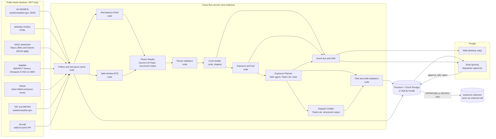
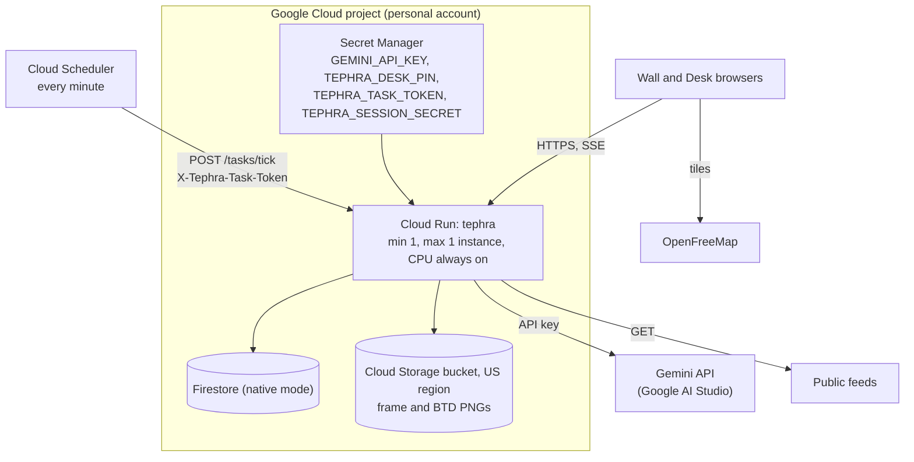

# TEPHRA architecture

TEPHRA is a volcanic-ash **decision desk** for airline dispatch. It is not a detection
system. The Volcanic Ash Advisory Centres (VAACs), the meteorological watch offices that
issue SIGMETs, and the volcano observatories say where the ash is. TEPHRA works on the step
after that. It answers four questions for a dispatcher:

1. Which of our flights are affected?
2. What should each one do?
3. How urgent is it, and what does it cost?
4. Where do the official sources disagree, and which ones are late?

Official products are binding. Gemini may widen the hazard but never shrink it. Every
advisory is decision support only, and a human dispatcher approves each one. The airline,
Ring of Fire Air (code RFA), is fictional and labelled as such everywhere. Approved
advisories go only to TEPHRA's own outbound queue and never to a real system.

## 1. The system

A tick runs every minute. It polls whatever is due, rebuilds each active volcano's
situation, and calls Gemini only when the call matters and the product texts or the BTD
indicator have changed (an unchanged input is asked again at most every 3 hours). It then
recomputes the cone and the exposure, plans and drafts for newly exposed flights (and again
when a flight's entry becomes more urgent), and pushes everything to the browsers over
Server-Sent Events. A volcano is **active** when any one of these holds:

- it has a VONA in the last 24 hours (VONAs are polled live only with
  `TEPHRA_VONA_LIVE=true`; replays serve recorded ones);
- the newest VAA a VAAC issued for it is current;
- a valid VA SIGMET names it, or names no catalogue volcano and lies within 300 km of it
  (the nearest such vent takes it).

## 2. Who does what at each step

| # | Step | Done by | Inputs | Output | Notes |
|---|---|---|---|---|---|
| 1 | Poll feeds | code | public URLs | `Sigmet`, `Vona`, `VaacAdvisory`, `Taf`, `Metar`, `AdsbSnapshot`, `WindProfile`, `SatelliteFrame` | Each record keeps its provenance: source id, URL, fetch time, the feed's own times, SHA-256. A failed fetch serves the last good copy, marked stale with its age (never for frames or HSD segments; an ADS-B copy older than 2 minutes counts as a failure). ADS-B, winds, frames and HSD read STALE with the reason when part of them fails. Each poll has a time budget. |
| 2 | Split-window BTD | code | Himawari-9 B13 and B15 segments | `BtdResult` and a PNG | Only with `TEPHRA_SCIENCE=1`. An indicator, never "detection". A silent or inconclusive result never narrows anything. |
| 3 | Find discrepancies | code | one volcano's products | `Discrepancy` list: CONFLICT, LAG, ENVELOPE, SILENCE, HEIGHT_MISMATCH, DIRECTION_MISMATCH | Deterministic, with tolerances of 2,000 ft and 45 degrees. A non-observation is never a CONFLICT. One office's SIGMETs never disagree with each other. SILENCE stays quiet while the VAAC's feed is failing or stale. |
| 4 | Read the plume | **Gemini** (`gemini-3.8-flash`) | raw texts, discrepancies, winds by FL, BTD stats and PNG, JMA satellite crops | `PlumeEstimate`: mode, FL band, bearing sector, extent, horizon, confidence, sources used, disagreements explained | Called only when the texts or the BTD indicator change (an unchanged input at most every 3 hours) and the call matters: a CAUTION or WARNING discrepancy, an ash VONA with no official polygon in force, or an airline aircraft within 250 NM. Code validates it, makes at most one repair call, then falls back to OFFICIAL, or, with no official polygon at all, to a code-built NO MODEL hypothesis. NICT true-colour frames are never sent. |
| 5 | Build the cone | code | estimate plus every valid official polygon | `HazardCone` | Always contains every official polygon, and the vertical band includes the official band. |
| 6 | Find exposed flights | code | cone and aircraft | `ExposedFlight` with minutes to entry and the hold fuel line | Projection holds the current track, speed and level, and tests each minute's segment, so a narrow crossing is not missed. Uses `alt_baro` and the selected altitude, never GNSS altitude. A position older than the lookahead is skipped. |
| 7 | Plan per flight | **ADK agent** (`gemini-3.5-flash-lite`) with tools | `PlannerContext` (flight, hazard band, alternates screened against TAFs, costs) | `PlannedAction`: CONTINUE, MONITOR, CHANGE_LEVEL, HOLD or DIVERT, with reasoning | Once per flight, cone and urgency (inside, within 15 min, within 30 min, later: the operator policy's divert and hold times). Tools are code. Validated, with one repair, then rule-based fallback. No waypoints, so no reroutes. |
| 8 | Draft the advisory | **Gemini** (`gemini-3.5-flash-lite`) | plan and context, with no clock times | `DraftText`: an ACARS-style body of 400 characters or fewer, and a cost note | Code renders the header (flight, UTC times, sources, hashes). Validated, with one repair, then a template fallback labelled NO MODEL. |
| 9 | Decide | **human** dispatcher on the Desk | DRAFT advisory | APPROVED, EDITED (both versions kept) or REJECTED (reason required) | Every transition is an audit entry. |
| 10 | Queue | code | APPROVED or EDITED advisory | `OutboundMessage` in the `outbound` collection | Never an external call. |

With `TEPHRA_LLM=stub` (and whenever a step falls back), steps 4, 7 and 8 are
deterministic code. The stub is labelled **NO MODEL** on every card, cone label and trace
line; a fallback says so in its trace line and on its card. Gemini 3 models run at their
default temperature of 1.0.

## 3. Safety rules and where each is enforced

| Rule | Enforced in |
|---|---|
| Official products are binding: the cone never shrinks below any valid official polygon | `geo/cone.build_cone` (union, never simplified; a folded feed ring counts as all it encloses) and the hypothesis property tests in `tests/test_geo.py` and `tests/test_geo_props.py`; `agents/plume_reader.validate_estimate` (top not below the official top) |
| No HYPOTHESIS cone while an official polygon is valid, and no OFFICIAL or WIDENED cone without one | `plume_reader.validate_estimate` |
| HYPOTHESIS cones allow only MONITOR or HOLD | `models.ALLOWED_ACTIONS`, `agents/validators.validate_decision` (the mode decides, whatever the context lists), `validators.validate_draft` (no divert or level-change wording), `exposure_planner.build_planner_context` |
| With no official polygon, a recent ash report still gets a sector | `plume_reader.validate_estimate` (a HYPOTHESIS beside a recent ash VONA must draw a sector and reach the reported top); with no usable answer, the fallback is the code-built NO MODEL hypothesis when the winds or the VONA's drift give a direction |
| No advice continues or holds an aircraft in the ash | `validators.validate_decision` (CONTINUE only with the present and selected levels clear of the hazard band plus margin; no hold inside the hazard; a hold at another level is a level change); `exposure_planner.rule_based_decision` (inside the hazard with no clear level or acceptable alternate: MONITOR, and the dispatcher advises the exit) |
| Sector of 180 degrees or less, extent of 500 km or less, horizon from 1 h to 18 h | `plume_reader.validate_estimate` with `config` safety constants |
| Gemini cites only sources it was given | `plume_reader.validate_estimate` (source ids and discrepancy ids); `plume_reader.build_parts` sends no image without a known source id |
| The model never writes a time, an id or a hash | validators reject clock times (with a zone word too, as in `1830 UTC`); `dispatch_drafter.render_header` writes them from provenance |
| No invented places | `validators.validate_draft` (ICAO codes and waypoint-like words must come from the input; the plain-word vocabulary holds no ICAO id or place name); the planner only diverts to `data/airports.json` alternates whose TAF passes and that lie outside the cone and more than the operator policy's terminal radius (20 NM, illustrative) from it |
| No invented numbers in the advisory | `validators.validate_draft` (every number in the body appears in the input) |
| "Not observed", a silent or inconclusive BTD, and silence never shrink the hazard or downgrade an action | `reconcile/discrepancies` (non-observations are evidence states, not CONFLICT); the plume validator (never the source leaned on, never a reason to narrow); the prompt |
| A feed outage never reads as an empty sky or a silent VAAC | `feeds.adsb.fetch_aircraft`, `feeds.vaac` (all ten Darwin slots down) and `feeds.satellite` raise instead of answering nothing; `feeds.registry` marks a partial ADS-B or per-volcano failure STALE; SILENCE stays quiet while the VAAC feed is degraded; `pipeline` retires no draft while ADS-B positions are stale |
| A human approves every advisory | `desk/approvals` (only DRAFT moves; a dispatcher session is required for approve, edit and reject) |
| Desk sessions and ticks cannot be forged | `config.Settings` (session secret and task token of 32 characters or more; blank values count as unset); `api/auth` (HMAC-signed HttpOnly SameSite=Strict cookie, CSRF guard on every desk POST, login throttle on the address Cloud Run appends, constant-time comparisons) |
| Nothing leaves TEPHRA | `desk/approvals` writes only to `outbound`; `HttpSource` is GET-only |
| Every transition is audited with inputs, model id and prompt hash | `desk/approvals` and `desk/audit` (append-only, hash-chained entries) |
| The airline is fictional and the tool is decision support only | `config.DISCLAIMER` in every page and every advisory header |
| Replay is always labelled | `SystemState.replay.banner`, shown as a permanent banner; `Provenance.replay`; `Advisory.replay`; `detail.replay` on every trace line in REPLAY; recorded and live advisories never dedupe or supersede each other |
| No secrets in the repo, and Gemini only via an AI Studio key | `config.Settings` reads env vars; `apply_process_env` pins `GOOGLE_GENAI_USE_VERTEXAI` and `GOOGLE_GENAI_USE_ENTERPRISE` to FALSE; `agents/llm` uses `genai.Client(api_key=..., vertexai=False)` only |
| Free-tier quota is respected | `Situation.input_hash` covers only the product texts and the BTD indicator; the quota gate in `pipeline` (an unchanged input is asked again at most every 3 h); per-tier daily budgets in `agents/llm`, counted per Google quota day and kept on disk, and a per-day 429 closes the tier; Flash-Lite for planner and drafter |
| Gemini sees only public feed content | `plume_reader.build_parts` and `PlannerContext`, which carry no dispatcher names, audit data or registrations; `pipeline` never sends NICT true-colour frames (research/05) |

## 4. Deploy topology

- **One instance.** The event bus that feeds SSE is in process. With `max-instances=1`, the
  scheduler's tick and every browser stream share it. CPU stays allocated, so the second
  ADS-B poll 30 s into each tick runs, and SSE connections stay alive between ticks. The
  minimum is one instance unless `TEPHRA_MIN_INSTANCES=0` is set at deploy time; a cold start
  then restores the state from Firestore.
- **Request slots.** Every open event stream holds one of the instance's request slots, so
  `TEPHRA_MAX_EVENT_STREAMS` (default 200) caps open streams, and it must stay below the
  service's `--concurrency`. A refused stream gets 503 with `Retry-After: 5`, and the pages
  reconnect by themselves.
- **Credentials.** `deploy/cloudrun.sh` creates the runtime service account `tephra-run`
  and gives it `roles/datastore.user`, `roles/storage.objectAdmin` on the bucket, and
  `roles/secretmanager.secretAccessor` on the four secrets. Gemini uses only the AI Studio
  key from Secret Manager. Vertex AI (Agent Platform) and Application Default Credentials
  are never used for Gemini. Firestore and Cloud Storage clients exist only when
  `TEPHRA_STORE=firestore`. The app refuses to start with a session secret or task token
  shorter than 32 characters.
- **Locally**, `TEPHRA_STORE=sqlite` writes to `.state/`, and `TEPHRA_LOCAL_SCHEDULER=1`
  runs the tick loop in process. Nothing needs a cloud account.
- Deploy scripts in `deploy/` take the project and region from the environment
  (`TEPHRA_PROJECT`, `TEPHRA_GCP_REGION`) and refuse the `default` gcloud configuration and
  any credential override. They are run by the user from a personal-account context, never
  by an agent on a machine whose gcloud is logged into another account. Cloud Scheduler
  calls the tick every minute with a 120 s attempt deadline.

## 5. Modes

| Mode | Clock | Feeds | Label |
|---|---|---|---|
| LIVE | system UTC | live HTTP with last-good cache | `LIVE` badge |
| REPLAY | recorded time, advancing (and looping) from the case start, or from `TEPHRA_REPLAY_START` | recorded responses from `data/replay/<case_id>/` matched by exact URL; a feed the case did not record reads DISABLED and is not polled | permanent banner `REPLAY: recorded real feeds from <date>`, plus `replay=true` on every provenance and advisory and on every trace line |
| Auto-replay | as REPLAY | as REPLAY, plus a live SIGMET poll to detect activity | as REPLAY, with `auto` marked |

Auto-replay starts only when `TEPHRA_AUTO_REPLAY=1` and, for three ticks running, no
volcano is active and no aircraft is exposed. It switches back to LIVE as soon as a live VA
SIGMET for a catalogue volcano becomes valid. A signed-in dispatcher can also switch mode,
and pick a case, from the desk (`POST /api/mode`). Every switch starts a fresh picture, so
nothing recorded and nothing live mix; recorded and live advisories never dedupe or
supersede each other. When the looping replay clock returns to the start, the picture
starts afresh too. A notice in a recorded page that was issued after the replay clock waits
for the clock. A replay case holds the raw recorded responses, each with its URL, fetch
time and SHA-256, plus a human label.

## 6. What is live, what is replay, what is ours

**Live and public (shown verbatim with source, time and hash):**
- every SIGMET polygon, flight-level band and movement;
- every VONA and VAA text;
- every satellite frame and Himawari segment (frames are cropped by TEPHRA, and their
  captions say so and name the source);
- every wind, TAF and METAR value;
- every aircraft position, ground speed, track and selected altitude;
- every timestamp on screen. Each one is copied from a feed field and none is written by
  the model.

**Replay (always labelled):** the same feeds, recorded earlier and played back on a clock
that starts at the recording time (or at `TEPHRA_REPLAY_START`). It is used when nothing is
erupting or no aircraft is near. A case rebuilt from archives (NOAAPort bulletins, AWC
history) says so in its manifest.

**Ours (and said out loud):**
- The airline and its operations centre are fictional. Every tracked airline aircraft
  stands in as a proxy flight `RFA####`, and its real callsign is shown next to it.
- Advisories go only to TEPHRA's own queue.
- Routes are extrapolated from track and ground speed, not from filed flight plans, which
  are not free.
- The hazard cone is TEPHRA's estimate with a mode and a confidence. It is never "the
  model saw ash".
- The BTD heat map is a code-computed indicator with known blind spots. Himawari-9 data
  come from JMA via NOAA and are processed by TEPHRA, so the map is not original JMA data.
- Fuel and minutes come from a simple, labelled formula, not airline performance tables.
- Alternate screening uses simplified planning minima.

## 7. Known limits

- The Gemini free tier is reported at about 20 requests a day for 3.8 Flash. TEPHRA
  therefore calls it only when inputs change (and asks again about an unchanged input at
  most every 3 hours), counts its calls per Google quota day across restarts, and falls back
  to code when the budget runs out or Google reports the day's quota spent. The UI shows
  that this happened.
- Live MAGMA VONA polling is off unless `TEPHRA_VONA_LIVE=true`, because MAGMA's robots.txt
  disallows crawling. Without it, VONAs reach TEPHRA only through replays.
- In the tropics, water vapour often masks the split-window signal. Small eruptions such as
  Semeru's often fall below resolution. A silent or inconclusive BTD is not evidence of no
  ash.
- Satellite frames are not georeferenced, so the Wall shows them in a side strip, never on
  the map. They are context only and never draw the cone. NICT true colour is off unless
  `TEPHRA_NICT_FRAMES=true` (its terms allow non-commercial use only).
- There is no free NOTAM or airway database. TEPHRA cannot see aerodrome closures, and it
  never proposes waypoint reroutes. No action kind means "leave the ash": inside the hazard
  with no clear level within the operator policy's level search (4,000 ft) and no acceptable
  alternate, the rules advise MONITOR and leave the exit to the dispatcher.
- An advisory cites the SIGMETs, VONA, VAA and wind profile it used, with their hashes. It
  names the aircraft (callsign and ICAO address) but does not cite its ADS-B snapshot.
- Every margin, buffer, minimum and threshold the code applies for the operator comes from
  `data/policy/policy_a.json` (Policy A), with its unit and the reason for its value. The
  values are illustrative, not an airline's safety risk assessment. Each advisory records
  the policy id and version it was drafted under, and so does every audit entry on it.
- BoM's Darwin VAA pages cannot be used (POST lists, no scraping). Live, Darwin's latest
  bulletins are polled from the ten NOAA tgftp slots and kept from then on; replays rebuild
  past ones from NOAAPort bulletins.
- Heights from different products are compared on one scale (FL x 100 = ft). The
  difference between pressure altitude and height above sea level is ignored, and this is
  labelled.
