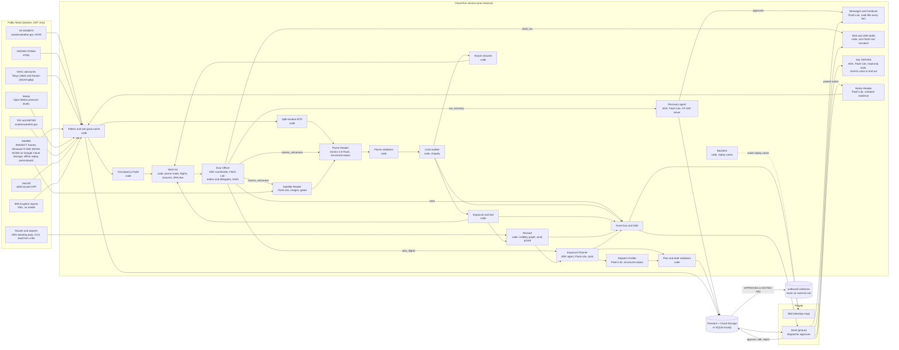
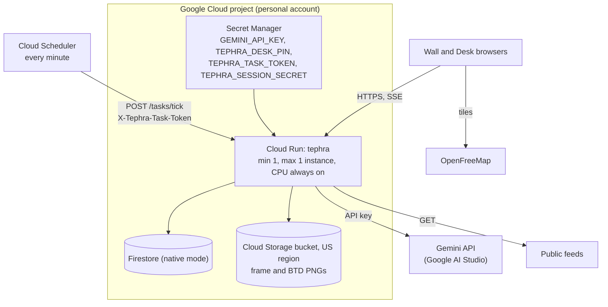

# TEPHRA architecture

TEPHRA is a volcanic-ash **decision desk** for airline dispatch. It is not a detection
system. The Volcanic Ash Advisory Centres (VAACs), the meteorological watch offices that
issue SIGMETs, and the volcano observatories say where the ash is. TEPHRA works on the step
after that. It answers these questions for a dispatcher:

1. Which of our flights are affected?
2. What should each one do, including a lateral route around the hazard?
3. How urgent is it, and what does it cost?
4. Where do the official sources disagree, and which ones are late?
5. Which airports does the ash close, and how do we re-plan the day's flights?
6. What do we tell crews and passengers, the next shift, and the regulator?

Official products are binding. Gemini may widen the hazard but never shrink it. Every
advisory, message, recovery plan and document is a draft until a human approves it, and the
airline, Ring of Fire Air (code RFA), is fictional and labelled as such everywhere. What is
approved goes only to TEPHRA's own outbound queue and never to a real system.

**No fallbacks.** When a model step fails, runs out of budget, or gives an answer that fails
the code's checks after at most one repair, the step reports `AI UNAVAILABLE: <reason>` and
nothing is substituted: no canned text, no rule-based stand-in, no template, no browser
speech. HTTP routes answer 503 `{"error": "ai_unavailable", "message": ...}`; a flight with
no plan or draft goes to the Desk as an AI failure for a dispatcher to handle by hand. Two
things look like fallbacks and are not. The cone is always built on the official polygons,
which are binding whatever the model does (a failed Plume Reader means "official products
only", labelled, not a guess). The reroute geometry, the recovery solver, the JMA XML parser
and the backtest metrics are the primary design of those steps. `TEPHRA_LLM=stub` is the
offline test mode: every model step then has a deterministic answer, labelled **NO MODEL**.

## 1. The system

A tick runs every minute. It polls whatever is due, rebuilds each active volcano's
situation and its discrepancies, and holds each hazard area at the official products (or the
last reading that still fits them). Code then finds the AI work that is due, with the same
gates as before: a plume read when the call matters and the product texts or the BTD
indicator have changed (an unchanged input is asked again at most every 3 hours), each
exposed flight in a new cone or a more urgent bucket, a changed set of RFA airports the
hazard closes, a region newly carrying exposed flights.

The **Duty Officer**, a Google ADK coordinator agent, gets that work list with a
code-written digest of the picture and the day's AI budget. It decides the order and
delegates through one tool per specialist: plume reads (Satellite Reader and Plume Reader,
after which code rebuilds the cone and the exposure, which may make new flights due), flight
plans (Exposure Planner and Dispatch Drafter, which uses the code's lateral reroutes),
network recovery and the SRA draft. It may defer optional work with a reason, and it ends
with a brief for the dispatchers (summary, priorities, what to watch), checked by code like
every other model output. Code holds the safety line: a volcano's plume read comes before its
flights' plans, mandatory work (a flight inside or about to enter the area, a volcano with
reported ash and no official area) cannot be deferred, undone mandatory work gets one repair
turn, and what is still undone goes to the Desk as `AI UNAVAILABLE`. Work is offered again
only after the policy's `duty.rerun_min`, so an unchanged list costs nothing. Everything is
pushed to the browsers over Server-Sent Events. A volcano is **active** when any one of these holds:

- it has a VONA in the last 24 hours (VONAs are polled live only with
  `TEPHRA_VONA_LIVE=true`; replays serve recorded ones). JMA eruption reports for the Kyushu
  volcanoes are polled live without that switch and count as VONAs; so does a pasted notice
  that passed every check;
- the newest VAA a VAAC issued for it is current;
- a valid VA SIGMET names it, or names no catalogue volcano and lies within 300 km of it
  (the nearest such vent takes it).

Ask TEPHRA, the Notice Reader, and the messages and handover brief run on demand from the
Desk. The recovery agent and the SRA drafter run when the Duty Officer dispatches them, or
when a dispatcher presses the button. The Satellite Reader runs only within a plume read the
Duty Officer dispatched, and only when the newest frame has changed.

## 2. Who does what at each step

| # | Step | Done by | Inputs | Output | Notes |
|---|---|---|---|---|---|
| 1 | Poll feeds | code | public URLs | `Sigmet`, `Vona` (MAGMA and JMA), `VaacAdvisory`, `Taf`, `Metar`, `AdsbSnapshot`, `WindProfile`, `SatelliteFrame` | Each record keeps its provenance: source id, URL, fetch time, the feed's own times, SHA-256. A failed fetch serves the last good copy, marked stale with its age (never for frames or HSD segments; an ADS-B copy older than 2 minutes counts as a failure). ADS-B, winds, frames and HSD read STALE with the reason when part of them fails. Each poll has a time budget. JMA's eruption reports (VFVO52 and VFVO56) are parsed by code into the same `Vona` shape. |
| 2 | Split-window BTD | code | Himawari-9 B13 and B15 segments | `BtdResult` and a PNG | Only with `TEPHRA_SCIENCE=1`. An indicator, never "detection". A silent or inconclusive result never narrows anything. |
| 3 | Find discrepancies | code | one volcano's products | `Discrepancy` list: CONFLICT, LAG, ENVELOPE, SILENCE, HEIGHT_MISMATCH, DIRECTION_MISMATCH | Deterministic, with tolerances of 2,000 ft and 45 degrees. A non-observation is never a CONFLICT. One office's SIGMETs never disagree with each other. SILENCE stays quiet while the VAAC's feed is failing or stale. |
| 4 | Read the satellite picture | **Gemini** (`gemini-3.5-flash-lite`, images) | the newest JMA Dust RGB and B13 frames, the official areas | `SatelliteReading`: ash visible yes, no or uncertain, cloud cover, boxes | Supporting evidence only: code turns boxes into places when a frame is georeferenced (the `se3` crops, an equirectangular grid; the Mercator `jpn` crops keep pixel boxes), and the text goes to the Plume Reader under its own `SAT-` id. It never narrows anything and never sets a height. Runs only inside a plume read the Duty Officer dispatched (step 8), and only when the newest frame is not the one the last reading used. Failure is `AI UNAVAILABLE` and is stored, so the same scan is not retried. |
| 5 | Read the plume | **Gemini** (`gemini-3.8-flash`) | raw texts, discrepancies, winds by FL, BTD stats and PNG, JMA satellite crops, the Satellite Reader's text | `PlumeEstimate`: mode, FL band, bearing sector, extent, horizon, confidence, sources used, disagreements explained | Dispatched by the Duty Officer (step 8); due only when the texts or the BTD indicator change (an unchanged input at most every 3 hours) and the call matters: a CAUTION or WARNING discrepancy, an ash VONA with no official polygon in force, or an airline aircraft within 250 NM. Code validates it and makes at most one repair call. If it still fails the outcome is `MODEL_FAILED`, `AI UNAVAILABLE`: the cone is the official products alone (they are binding), and with no official polygon nothing is drawn. NICT true-colour frames are never sent. |
| 6 | Build the cone | code | estimate plus every valid official polygon | `HazardCone` | Always contains every official polygon, and the vertical band includes the official band. |
| 7 | Find exposed flights | code | cone and aircraft | `ExposedFlight` with minutes to entry and the hold fuel line | Projection holds the current track, speed and level, and tests each minute's segment, so a narrow crossing is not missed. Uses `alt_baro` and the selected altitude, never GNSS altitude. A position older than the lookahead is skipped. |
| 8 | Dispatch the AI work | **ADK coordinator** (`gemini-3.5-flash-lite`), the **Duty Officer** | the work list code found due (plume reads, flights, closures, SRA) and a code-written digest with the AI budget | `DutyRun`: the delegations made, deferrals with reasons, and a `DutyBrief` (summary, priorities, watch) | Delegates through tools only (`assess_volcanoes`, `plan_flights`, `run_recovery`, `draft_sra`, `defer`, `submit_brief`); never writes advice itself. Code refuses a plan before its volcano's plume read and a deferral of mandatory work; the brief's numbers and flights must come from what it was shown, with no clock times. One repair turn when the brief fails or mandatory work is undone; then undone mandatory flights go to the Desk as AI failures (stage `duty_officer`) and an undone plume read leaves the official area, audited. Runs only when there is work it has not been offered for `duty.rerun_min`. |
| 9 | Compute lateral reroutes | code | exposed flight, cone, winds, published route | `RerouteOption` per kind (REJOIN_TRACK, DIRECT_DEST) with a status, waypoints, extra NM and minutes, fuel, a route string | A visibility graph around the cone's buffered obstacle (the convex hull of each connected piece, always a superset of the hazard), priced in minutes of wind at the flight level, in a local azimuthal plane. At most 3 turn points, turns of 90 degrees or less, extra time between 1 and 30 minutes. No airways: free-route direct legs between latitude and longitude points. The destination comes from VRS standing data (callsign to airport chain) when the aircraft is on one of its legs, else the option is `NO_DEST`. None in HYPOTHESIS mode. A route that cannot be found is a status (`NO_ROUTE`, `TOO_LONG`, `NO_BENEFIT`, ...), never a guessed path. |
| 10 | Plan per flight | **ADK agent** (`gemini-3.5-flash-lite`) with tools | `PlannerContext` (flight, hazard band, alternates screened against TAFs, reroute options, costs) | `PlannedAction`: CONTINUE, MONITOR, CHANGE_LEVEL, HOLD, DIVERT or REROUTE (choosing one of the code's routes by id), with reasoning | Once per flight, cone and urgency (inside, within 15 min, within 30 min, later: the operator policy's divert and hold times). Tools are code. The prompt states the CAP 1236 order: lateral avoidance first, then level change, then hold or diversion. Validated, with one repair. If it still fails there is no plan: the flight goes to the Desk as an AI failure. |
| 11 | Draft the advisory | **Gemini** (`gemini-3.5-flash-lite`) | plan and context, with no clock times | `DraftText`: an ACARS-style body of 400 characters or fewer, and a cost note | Code renders the header (flight, UTC times, sources, hashes). A REROUTE body must contain the route string verbatim, and coordinates are accepted only as written in it. Validated, with one repair. If it still fails there is no draft: AI failure on the Desk. |
| 12 | Decide | **human** dispatcher on the Desk | DRAFT advisory | APPROVED, EDITED (both versions kept) or REJECTED (reason required) | Every transition is an audit entry. |
| 13 | Queue | code | APPROVED or EDITED advisory | `OutboundMessage` in the `outbound` collection | Never an external call. |
| 14 | Find closed airports | code | cones, official layers, TAFs and METARs, the RFA schedule's airports | `Closure` per airport with a window and code-written reason | An airport is closed while a hazard area from the surface to FL100 comes within the policy's radius (20 NM), or its TAF or METAR carries `VA`. |
| 15 | Recover the network | **ADK agent** (`gemini-3.5-flash-lite`) around a **CP-SAT solver** | closures, the synthetic RFA schedule (30 tails, 142 flights) | `RecoveryPlan` (DRAFT): three scenarios (closure as forecast, +3 h, +6 h), per-flight keep, delay, cancel or swap, totals, a rationale | The solver minimises the policy's cost weights under turn, duty and closure constraints, and returns `NO_PLAN` rather than a greedy plan. The agent compares scenarios and recommends one; every number in its rationale must come from a tool result. Dispatched by the Duty Officer once the set of closed airports changes, or started from the Desk. A dispatcher approves or rejects. |
| 16 | Draft messages | **Gemini** (`gemini-3.5-flash-lite`) | an approved advisory or recovery plan | `CrewPaxMessage` drafts: crew briefing, crew notice per tail, passenger notice per cancelled or delayed flight (a delay shorter than the policy's 30 minutes gets none) | The model writes one template per language with placeholders and never sees a fact; code fills flight, route, local times, delay, reason with its source ids and the PM 89/2015 wording. A validator rejects any digit outside a placeholder. Languages follow the route: Bahasa Indonesia and English, Japanese and English, or English. DRAFT until a dispatcher approves, edits or rejects; approval queues it in `outbound`. |
| 17 | Hand over the shift | code and **Gemini** (`gemini-3.5-flash-lite`) | audit entries, open drafts, AI failures, feeds | `HandoverBrief` (WEST and I-PASS) | Code gathers every fact and sets the severity; the model writes only the situation and contingencies, each with source ids and no invented numbers. Open drafts are listed as "handed over open"; the incoming dispatcher's read-back is allowed and records which were still open. |
| 18 | Regulator paperwork | code and **Gemini** (`gemini-3.5-flash-lite`) | the evidence of a region (SRA) or an exposed flight (VAR) | `SraDraft`, `VarDraft` | Headed `DRAFT - NOT AN APPROVED SRA - FOR HUMAN SIGN-OFF`. Code fills every table; one model call writes four short narrative boxes for the SRA. The VAR makes no model call: crew observations are never invented. Unfilled fields stay blank. Signatures are recorded per role; nothing is queued. |
| 19 | Read a pasted notice | **Gemini** (`gemini-3.5-flash-lite`) | a notice in English, Bahasa Indonesia, Japanese or Filipino | `NoticeReading`: fields with verbatim evidence | Verified only if every claim's evidence is a verbatim substring, numbers and enums match it, the volcano is in the catalogue, and the notice states a date, a clock time and a zone word. A verified notice joins the live picture as a VONA; an unverified one stays raw text with a badge. |
| 20 | Answer a question | **ADK agent** (`gemini-3.5-flash-lite`), Gemini speech | a typed or spoken question | `AskAnswer` with claims, each citing evidence from a read-only tool | Tools only read the runtime (including the Duty Officer's latest brief) or run what-if exposure checks that change nothing. Every number, flight and ICAO code in the answer must appear in a cited tool result. Out-of-scope questions ("is it safe") are refused. Voice in is one transcription call; voice out is the Gemini TTS model. |
| 21 | Backtest | code | the replay cases in `data/replay/` | `BacktestScorecard`: coverage, gain over the official baseline, over-warning, lead time | Replays each case on a fixed clock with the stub plume reader (arm D); arm G replays cached Gemini reads and is run by hand. The prose report is one model call, checked number by number, and absent when it fails. |

With `TEPHRA_LLM=stub`, every model step has a deterministic answer for tests, labelled
**NO MODEL** on every card, cone label and trace line. Voice in and out have none: they
answer `AI UNAVAILABLE`. Gemini 3 models run at their default temperature of 1.0.

## 3. Safety rules and where each is enforced

| Rule | Enforced in |
|---|---|
| Official products are binding: the cone never shrinks below any valid official polygon | `geo/cone.build_cone` (union, never simplified; a folded feed ring counts as all it encloses) and the hypothesis property tests in `tests/test_geo.py` and `tests/test_geo_props.py`; `agents/plume_reader.validate_estimate` (top not below the official top) |
| No HYPOTHESIS cone while an official polygon is valid, and no OFFICIAL or WIDENED cone without one | `plume_reader.validate_estimate` |
| HYPOTHESIS cones allow only MONITOR or HOLD | `models.ALLOWED_ACTIONS`, `agents/validators.validate_decision` (the mode decides, whatever the context lists), `validators.validate_draft` (no divert or level-change wording), `exposure_planner.build_planner_context` |
| With no official polygon, a recent ash report still gets a sector | `plume_reader.validate_estimate` (a HYPOTHESIS beside a recent ash VONA must draw a sector and reach the reported top). If the model gives no usable answer there is no hypothesis cone and the trace says `AI UNAVAILABLE`; only the stub backend builds the NO MODEL hypothesis, for tests |
| No advice continues or holds an aircraft in the ash | `validators.validate_decision` (CONTINUE only with the present and selected levels clear of the hazard band plus margin; no hold inside the hazard; a hold at another level is a level change); `exposure_planner.rule_based_decision` (the stub backend's plan; inside the hazard with no clear level or acceptable alternate: MONITOR, and the dispatcher advises the exit) |
| Sector of 180 degrees or less, extent of 500 km or less, horizon from 1 h to 18 h | `plume_reader.validate_estimate` with `config` safety constants |
| Gemini cites only sources it was given | `plume_reader.validate_estimate` (source ids and discrepancy ids); `plume_reader.build_parts` sends no image without a known source id |
| The model never writes a time, an id or a hash | validators reject clock times (with a zone word too, as in `1830 UTC`); `dispatch_drafter.render_header` writes them from provenance |
| No invented places | `validators.validate_draft` (ICAO codes and waypoint-like words must come from the input; the plain-word vocabulary holds no ICAO id or place name); the planner only diverts to `data/airports.json` alternates whose TAF passes and that lie outside the cone and more than the operator policy's terminal radius (20 NM, illustrative) from it |
| No invented numbers in the advisory | `validators.validate_draft` (every number in the body appears in the input) |
| "Not observed", a silent or inconclusive BTD, and silence never shrink the hazard or downgrade an action | `reconcile/discrepancies` (non-observations are evidence states, not CONFLICT); the plume validator (never the source leaned on, never a reason to narrow); the prompt |
| A feed outage never reads as an empty sky or a silent VAAC | `feeds.adsb.fetch_aircraft`, `feeds.vaac` (all ten Darwin slots down) and `feeds.satellite` raise instead of answering nothing; `feeds.registry` marks a partial ADS-B or per-volcano failure STALE; SILENCE stays quiet while the VAAC feed is degraded; `pipeline` retires no draft while ADS-B positions are stale; an advisory drafted while the SIGMET or the volcano's VAAC feed is failing, stale or never polled carries `OFFICIAL PICTURE INCOMPLETE: <FEED> NOT UPDATED SINCE <DDHHMMZ or NEVER>` in its header (`reconcile/discrepancies.feed_degraded`, `dispatch_drafter.render_header`; information only, it changes no action) |
| Dispatch advises route and level, never engine handling | `validators.validate_draft` and the Desk edit path (`desk/approvals.edit_and_approve`) reject a body with thrust, idle, autothrottle, escape-manoeuvre or descending and 180-degree turn wording; the drafter prompt says the crew's own procedures cover an encounter |
| Vertical avoidance is labelled, not hidden | Policy A advises avoiding the area. When a CHANGE_LEVEL band, or a CONTINUE flight's present level, lies wholly above the hazard top or below its base by more than the margin, `dispatch_drafter.render_header` adds an `OVER ASH` or `UNDER ASH` line with the clearance in feet, citing Doc 9974 App 5 5.4(d)(2), and says no drift-down or escape check was made |
| A human approves every advisory | `desk/approvals` (only DRAFT moves; a dispatcher session is required for approve, edit and reject) |
| Desk sessions and ticks cannot be forged | `config.Settings` (session secret and task token of 32 characters or more; blank values count as unset); `api/auth` (HMAC-signed HttpOnly SameSite=Strict cookie, CSRF guard on every desk POST, login throttle on the address Cloud Run appends, constant-time comparisons) |
| Nothing leaves TEPHRA | `desk/approvals` writes only to `outbound`; `HttpSource` is GET-only |
| Every transition is audited with inputs, model id and prompt hash | `desk/approvals` and `desk/audit` (append-only, hash-chained entries) |
| The airline is fictional and the tool is decision support only | `config.DISCLAIMER` in every page and every advisory header |
| Replay is always labelled | `SystemState.replay.banner`, shown as a permanent banner; `Provenance.replay`; `Advisory.replay` and `Advisory.replay_case_id`; a `REPLAY - ... - NOT LIVE` line right after the flight line of every REPLAY advisory header, naming the case and whether it was reconstructed from archives or recorded from live feeds (`dispatch_drafter.render_header`); `OutboundMessage.replay` and `replay_case_id` on every queued REPLAY advisory, and `GET /api/outbound` orders by the wall-clock `queued_wall_at`, so recorded and live rows never interleave by replay time; `detail.replay` on every trace line in REPLAY; recorded and live advisories never dedupe or supersede each other |
| No secrets in the repo, and Gemini only via an AI Studio key | `config.Settings` reads env vars; `apply_process_env` pins `GOOGLE_GENAI_USE_VERTEXAI` and `GOOGLE_GENAI_USE_ENTERPRISE` to FALSE; `agents/llm` uses `genai.Client(api_key=..., vertexai=False)` only |
| Free-tier quota is respected | `Situation.input_hash` covers only the product texts and the BTD indicator; the quota gate in `pipeline` (an unchanged input is asked again at most every 3 h); per-tier daily budgets in `agents/llm`, counted per Google quota day and kept on disk, and a per-day 429 closes the tier; every new step runs on the Flash-Lite tier and none runs unconditionally each tick (satellite reading is gated by the Plume Reader call and a changed frame, recovery by a change in the closed airports, the rest on demand); `GET /api/budget` and the SSE `budget` event show the counts |
| A failed model step substitutes nothing | every model step returns an explicit failure (`AI UNAVAILABLE: <reason>`): `plume_reader` (`MODEL_FAILED`, official products only), `exposure_planner` and `dispatch_drafter` (`AiFailure`, handled by hand on the Desk via `desk/failures`), `ask`, `voice`, `notice_reader`, `satellite_reader`, `recovery/agent`, `comms/messages`, `comms/handover`, `regdocs/narrative`, `backtest/report` (HTTP 503 `ai_unavailable`, a stored failure, an audit or trace line). Voice has no stub answer and there is no browser speech |
| A reroute never enters the hazard | `geo/reroute` routes around the convex hull of each connected piece of the cone buffered by `reroute.buffer_nm` (illustrative 20 NM): always a superset of the hazard, so a reroute can only be wider than the cone. A route is re-checked against the buffer after its turn points are rounded to one arc-minute, and `tests/test_reroute.py` property-tests that no OK route enters the unbuffered cone. No named waypoint is ever invented, and a route that cannot be found is a status, not a path. The planner may only pick a route by its id; the drafter may only write coordinates that appear in the route string |
| Nothing a model writes carries a number or a place it was not given | `agents/validators`, `ask.validate_reply`, `comms/messages.template_problems` (no digit outside a placeholder), `comms/handover.narrative_problems`, `regdocs/narrative.validate_narrative`, `recovery/tools` (every number in the rationale comes from a tool result), `notice_reader.check_extraction` (every claim needs verbatim evidence), `backtest/report.validate_prose` |
| Supporting evidence never narrows the hazard | the Satellite Reader and a pasted notice only add: the Plume Reader's prompt and `validate_estimate` forbid leaning on a non-observation; `satellite_reader.validate_extraction` rejects "no ash" while cloud may cover the area and any SO2 claim; an unverified notice never reaches the pipeline |
| Anything that would leave TEPHRA is a draft until a human decides | messages, recovery plans, SRA and VAR drafts, advisories: `desk/approvals`, `comms/messages`, `recovery/decisions`, `regdocs/registry`; each transition is an audit entry, and approved messages go only to `outbound` |
| A recovery plan is solver output or nothing | `recovery/solver` returns `NO_PLAN` with the solver status when CP-SAT finds none; the agent only compares and recommends scenarios the solver made |
| Only the Desk page may ask for the microphone | `api/server` sends `Permissions-Policy: microphone=(self)` on `/desk` and `microphone=()` everywhere else; the CSP gains `media-src 'self' blob:` for spoken answers and no script host |
| Gemini sees only public feed content | `plume_reader.build_parts` and `PlannerContext`, which carry no dispatcher names, audit data or registrations; `pipeline` never sends NICT true-colour frames (research/05) |

### How the official floor is merged (Policy A)

`geo/cone.official_layers` and `geo/cone.build_cone` build one cone per volcano. What the code
does:

- It takes every official layer matched to that volcano: each SIGMET polygon, and each area of
  the newest current VAA from each VAAC (the observation and every forecast step). Each band of
  a two-layer VAA or SIGMET is its own layer. A layer is kept while it is still valid at the
  tick and starts within the 18 h planning horizon.
- The lateral area is the union of all those polygons, plus the model's sector when there is one.
- The vertical band is one band for the whole union, from the lowest base to the highest top of
  any layer (and of the model's estimate). So the separately banded areas of a two-layer VAA or
  SIGMET, such as SFC/FL200 moving south-east and SFC/FL500 moving west, become one area from
  the surface to FL500.
- Layers of different volcanoes are never merged: each volcano has its own cone.

This is a conservative operator choice under Doc 9974 2.4(d) (the operator resolves conflicts
among its data sources), not a requirement of App 5 5.4(d)(2), which only says to treat an area
with no contamination grading as high contamination. Its cost is extra caution: a flight above
the lower layer's top but inside that layer's lateral area counts as exposed.

## 4. Deploy topology

- **One instance.** The event bus that feeds SSE is in process. With `max-instances=1`, the
  scheduler's tick and every browser stream share it. CPU stays allocated, so the second
  ADS-B poll 30 s into each tick runs, and SSE connections stay alive between ticks. The
  minimum is one instance unless `TEPHRA_HOSTING=on-demand` is set at deploy time. The limit
  holds per revision, so during a rollout the old revision's instance stays up while its
  streams are open, beside the new one. Only the serving revision gets ticks, so each tick
  (not the startup tick) writes `runtime/writer` (revision, instance, time). An instance that
  finds a newer writer there (on an ADS-B pass, or its 60 s watchdog) retires: it stops ADS-B
  passes and checkpoints, and ends its open streams so browsers reconnect to the serving
  revision. With Cloud Scheduler, three tick intervals with no tick also end the open streams
  once. A hidden Wall gives its stream back after 5 minutes.
- **Restarts.** A cold start restores from Firestore the official products still current
  (SIGMETs, VONAs, VAAs), feed health, the LIVE bookkeeping (planned flights, the latest plume
  assessments, the closed-airport set), the newest satellite reading per volcano, the stored
  reroutes and the last Duty Officer run, and the replay choice: a replay picked on the Desk
  resumes on the same case, an automatic one while auto-replay is on and no live VA SIGMET is
  active, each from the case's start and with an audit entry. Aircraft, exposures, cones and
  the Wall are not stored; without the local scheduler the app runs one startup tick at once,
  so the picture rebuilds within one tick instead of waiting for Cloud Scheduler.
- **Database errors.** A feed record joins the in-memory picture before it is written; a
  failed write keeps it on the map and retries it at the next checkpoint, and the feed still
  reads OK. When the open drafts cannot be read, planning and draft retirement wait a tick
  with a note, rather than treating the unread list as empty. A step of the tick that raises
  becomes a note and a trace line, and the Wall is still published. The feed-health dialog
  has a Database row, and the Drafts count reads "unknown (database error)" when it could
  not be counted.
- **Request slots.** Every open event stream holds one of the instance's request slots, so
  `TEPHRA_MAX_EVENT_STREAMS` (default 200) caps open streams, and it must stay below the
  service's `--concurrency`. A refused stream gets 503 with `Retry-After: 5`, and the pages
  reconnect by themselves.
- **Credentials.** `deploy/cloudrun.sh` creates the runtime service account `tephra-run`
  and gives it `roles/datastore.user`, `roles/storage.objectAdmin` on the bucket, and
  `roles/secretmanager.secretAccessor` on the four secrets. Gemini uses only the AI Studio
  key from Secret Manager. Vertex AI (Agent Platform) and Application Default Credentials
  are never used for Gemini. Firestore and Cloud Storage clients exist only when
  `TEPHRA_STORE=firestore`. The app refuses to start with a session secret or task token
  shorter than 32 characters.
- **Image contents.** The image holds `tephra/`, `data/` (the catalogues, the policy, the RFA
  schedule, `routes_apac.json` and the replay cases) and `docs/backtest/` (the scorecard that
  `GET /api/backtest` serves when the store has none).
- **Locally**, `TEPHRA_STORE=sqlite` writes to `.state/`, and `TEPHRA_LOCAL_SCHEDULER=1`
  runs the tick loop in process. Nothing needs a cloud account.
- Deploy scripts in `deploy/` take the project and region from the environment
  (`TEPHRA_PROJECT`, `TEPHRA_GCP_REGION`) and refuse the `default` gcloud configuration and
  any credential override. They are run by the user from a dedicated personal-account gcloud
  configuration, never by an agent. Cloud Scheduler calls the tick every minute with a 120 s
  attempt deadline.

### Scaling path and running cost

- **One instance today, on purpose.** The event bus behind SSE is in process, and one pipeline
  is the single writer of the picture, the drafts and the hash-chained audit. A second
  instance would split the streams and race on the audit chain, so `max-instances=1`.
- **What would change for more airlines.** The in-process bus would become a shared,
  store-backed event feed that any instance can stream from. One writer per region would run
  the tick, so each audit chain keeps a single writer. Each airline would get its own policy
  file under `data/policy/` and its own desk, over the same public-feed picture. None of this
  is built.
- **Model calls are gated and budgeted, off the tick.** No model step runs every tick without a
  gate (section 3, free-tier row), and no tick makes a model call: an AI worker runs the
  scheduled work, urgent work first (a recovery run goes on beside it, so urgent work never
  waits behind one). Each model has a daily budget, its free limit less a 10% margin (18 for
  the main model, 450 for Flash-Lite, 9 for speech), counted per model and Google quota day in
  the store, every attempt before it is sent; if the store cannot be read, no call goes. Routine
  work is paced through the day and waits, visibly, for its next slot; once started it finishes
  within the daily cap. A REPLAY loop reuses the first pass's answers to exactly the same
  questions. Past a budget a step reports `AI UNAVAILABLE` and nothing is substituted.
- **Cost per advisory is not stated.** Once token totals are recorded on each plume
  assessment and planned action (a separate change), a replay can measure the tokens behind
  one advisory. Until that is measured, no cost figure is given.

### If TEPHRA is unavailable

TEPHRA is decision support; the operator's own procedure stays in force without it.

- Dispatch returns to the operator's own VAA, SIGMET and NOTAM briefing.
- Drafts that were not approved before the outage are void. They are not sent later.
- Crews still avoid ash they see, whatever TEPHRA showed.
- The duty manager declares the outage and, later, the recovery. After recovery, dispatchers
  check TEPHRA's picture against the current official products before acting on it.

## 5. Modes

| Mode | Clock | Feeds | Label |
|---|---|---|---|
| LIVE | system UTC | live HTTP with last-good cache | `LIVE` badge |
| REPLAY | recorded time, advancing (and looping) from the case start, or from `TEPHRA_REPLAY_START` | recorded responses from `data/replay/<case_id>/` matched by exact URL; a feed the case did not record reads DISABLED and is not polled | permanent banner `REPLAY: recorded real feeds from <date>`, plus `replay=true` on every provenance and advisory and on every trace line |
| Auto-replay | as REPLAY | as REPLAY, plus a live SIGMET poll to detect activity | as REPLAY, with `auto` marked |

Auto-replay starts only when `TEPHRA_AUTO_REPLAY=1` and, for three ticks running, no
volcano is active and no aircraft is exposed. It switches back to LIVE as soon as a live VA
SIGMET for a catalogue volcano becomes valid. A signed-in dispatcher can also switch mode,
and pick a case, from the desk (`POST /api/mode`). Every switch starts a fresh picture, so
nothing recorded and nothing live mix; recorded and live advisories never dedupe or
supersede each other. When the looping replay clock returns to the start, the picture
starts afresh too. A notice in a recorded page that was issued after the replay clock waits
for the clock. A replay case holds the raw recorded responses, each with its URL, fetch
time and SHA-256, plus a human label.

## 6. What is live, what is replay, what is ours

**Live and public (shown verbatim with source, time and hash):**
- every SIGMET polygon, flight-level band and movement;
- every VONA and VAA text;
- every satellite frame and Himawari segment (frames are cropped by TEPHRA, and their
  captions say so and name the source);
- every wind, TAF and METAR value;
- every aircraft position, ground speed, track and selected altitude;
- every timestamp on screen. Each one is copied from a feed field and none is written by
  the model.

**Replay (always labelled):** the same feeds, recorded earlier and played back on a clock
that starts at the recording time (or at `TEPHRA_REPLAY_START`). It is used when nothing is
erupting or no aircraft is near. A case rebuilt from archives (NOAAPort bulletins, AWC
history) says so in its manifest.

**Ours (and said out loud):**
- The airline and its operations centre are fictional. Every tracked airline aircraft
  stands in as a proxy flight `RFA####`, and its real callsign is shown next to it.
- Advisories go only to TEPHRA's own queue.
- The exposure projection extrapolates track and ground speed. A reroute's destination comes
  from VRS standing data, which is crowd-sourced and may be stale, and only when the aircraft
  lies near a leg of its callsign's chain and flies along it. Filed flight plans are not free.
- The RFA schedule, fleet and crews behind the recovery plans are synthetic (fixed seed, in
  `data/rfa/`). Recovery costs, minimum turn times and the passenger-notice minimum are
  illustrative policy values.
- The hazard cone is TEPHRA's estimate with a mode and a confidence. It is never "the
  model saw ash".
- The BTD heat map is a code-computed indicator with known blind spots. Himawari-9 data
  come from JMA via NOAA and are processed by TEPHRA, so the map is not original JMA data.
- Fuel and minutes come from a simple, labelled formula, not airline performance tables.
- Alternate screening uses simplified planning minima.

## 7. Known limits

- The Gemini free tier is reported at about 20 requests a day for 3.8 Flash and 500 for
  3.5 Flash-Lite. TEPHRA therefore calls the main model only when inputs change (and asks
  again about an unchanged input at most every 3 hours), counts its calls per Google quota
  day across restarts, and reports `AI UNAVAILABLE` when the budget runs out or Google
  reports the day's quota spent. It substitutes nothing, and the UI shows the failure.
  Ask TEPHRA costs up to about four Flash-Lite calls a question, so the budget guard, not
  the question rate, caps the spend.
- Live MAGMA VONA polling is off unless `TEPHRA_VONA_LIVE=true`, because MAGMA's robots.txt
  disallows crawling. Without it, VONAs reach TEPHRA only through replays.
- In the tropics, water vapour often masks the split-window signal. Small eruptions such as
  Semeru's often fall below resolution. A silent or inconclusive BTD is not evidence of no
  ash.
- Satellite frames are not georeferenced, so the Wall shows them in a side strip, never on
  the map. They are context only and never draw the cone. NICT true colour is off unless
  `TEPHRA_NICT_FRAMES=true` (its terms allow non-commercial use only).
- There is no free NOTAM or airway database. TEPHRA cannot see aerodrome closures it has not
  inferred from the hazard and the TAFs and METARs, and a reroute is a free-route path of
  direct legs between latitude and longitude points, not an airway route. A route needing
  more than three turn points is refused (in a benchmark of 200 flights past a jagged,
  four-part cone, 83 of 200 got no route at three, 26 at four, 3 at six). Inside the hazard
  with no clear level within the operator policy's level search (4,000 ft) and no acceptable
  alternate, the stub rules advise MONITOR and a model plan must satisfy the same validators.
- The Satellite Reader reads JMA Dust RGB, which cannot tell ash from dust or show SO2, and
  today's frames carry no georeference, so its boxes stay pixel boxes. It is supporting
  evidence only.
- Recovery and message drafts are on demand or on a change in the closed airports; nothing
  re-plans the day by itself as the hazard moves. The Indonesian and Japanese wording of the
  message packs is the team's own and needs a native-speaker check. The Backtest's Gemini
  arm (G) and its prose report have not been run; arm D (the stub reader) never beats the
  official baseline by construction.
- An advisory cites the SIGMETs, VONA, VAA and wind profile it used, with their hashes. It
  names the aircraft (callsign and ICAO address) but does not cite its ADS-B snapshot.
- Every margin, buffer, minimum and threshold the code applies for the operator comes from
  `data/policy/policy_a.json` (Policy A), with its unit and the reason for its value. The
  values are illustrative, not an airline's safety risk assessment. Each advisory records
  the policy id, version and short content hash (12 hex characters) it was drafted under,
  and every audit entry the advisory state machine writes on it, `OUTBOUND_QUEUED`
  included, carries all three; so does its `OutboundMessage`. Audit entries a crew or
  passenger message writes against its advisory do not yet carry them.
- BoM's Darwin VAA pages cannot be used (POST lists, no scraping). Live, Darwin's latest
  bulletins are polled from the ten NOAA tgftp slots and kept from then on; replays rebuild
  past ones from NOAAPort bulletins.
- Heights from different products are compared on one scale (FL x 100 = ft). The
  difference between pressure altitude and height above sea level is ignored, and this is
  labelled.
